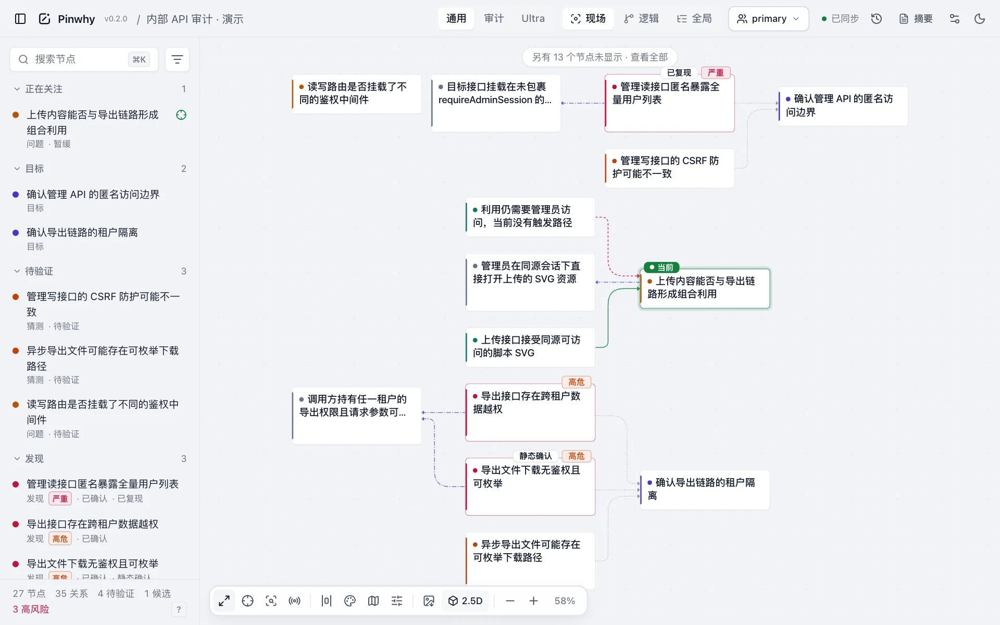
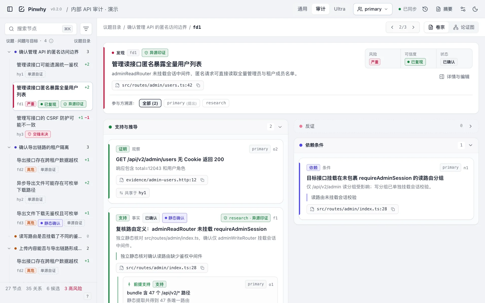

<p align="center">
  <picture>
    <source media="(prefers-color-scheme: dark)" srcset="docs/assets/pinwhy-logo-light.svg">
    
  </picture>
</p>

<p align="center">面向 AI Agent 的本地状态记录工具与可视化工作台</p>

<p align="center">
  <a href="https://pinwhy.bx33661.com">官网</a> ·
  <a href="#quick-start">安装</a> ·
  <a href="#daily-use">用法</a> ·
  <a href="#cli">命令</a> ·
  <a href="#documentation">文档</a> ·
  <a href="https://github.com/Fruit-Guardians/pinwhy/issues">反馈</a>
</p>

<p align="center">
  <a href="https://www.npmjs.com/package/pinwhy"></a>
  <a href="https://nodejs.org/">= 18"></a>
  
  <a href="LICENSE"></a>
</p>

<a id="workspace"></a>

<p align="center">
  <picture>
    <source media="(prefers-color-scheme: dark)" srcset="docs/assets/workspace-dark.webp">
    
  </picture>
</p>

<a id="introduction"></a>

## 简介

在多轮排障、代码阅读或安全审计中，上下文压缩和会话切换容易丢失已确认的事实、已排除的假设和未解决的问题。

Pinwhy 把目标、假设、证据、有向关系和检查点以追加事件日志写入项目本地 `.pinwhy/events.jsonl`。Agent 通过 CLI 按 Token 预算读回上下文，开发者通过本地 Web 工作台查看推理结构或直接补充记录。

<a id="features"></a>

## 功能

- **结构化记录**：独立保存目标、问题、假设、观察与发现，支持 `supports`、`contradicts`、`depends-on`、`supersedes` 等有向关系；状态、严重度与可信度正交记录，不自动推断。
- **预算化恢复与多 Agent 协作**：通过检查点和 `pinwhy context` 输出只读上下文；多个 Agent 共享同一事件日志，保留各自的写入署名与关注游标。
- **本地 Web 工作台**：内置通用视图（2D / 2.5D）、安全审计视图（议题矩阵与正反证据对照）以及可选的 `pinwhy-ultra` 文件切片覆盖视图。
- **零依赖与离线导出**：零运行时第三方依赖，数据保存在 `.pinwhy/`（初始化自动生成 `.gitignore`），支持导出单文件 HTML、Markdown、Mermaid 和 SARIF 2.1.0。

<a id="requirements"></a>
<a id="manual-install"></a>
<a id="quick-start"></a>

## 安装与接入

运行环境：**Node.js >= 18**（macOS / Linux / Windows）。

### 1. 安装 CLI

```sh
npm install -g pinwhy
pinwhy --version
```

安装包包含 CLI、已构建的 Web 工作台和 Agent Skill。

<a id="agent-integration"></a>

### 2. 配置宿主环境

| 宿主 | 命令 |
| --- | --- |
| Claude Code（初始化 + Skill + 恢复 Hook + 服务） | `pinwhy setup --title "项目名称" --open` |
| Codex / Cursor / Gemini CLI / OpenCode / Copilot CLI / OMP | `pinwhy init --title "项目名称"`<br>`pinwhy skill install`（或加 `--user` 全局安装）<br>`pinwhy serve --open` |
| DeepSeek Harness | 安装可选插件 [`dsh-pinwhy`](https://github.com/Fruit-Guardians/pinwhy/blob/main/plugins/dsh-pinwhy/README.md) |

也可以直接把下面指令发给当前项目里的 Agent 完成接入：

> 请阅读 https://github.com/Fruit-Guardians/pinwhy ，为当前项目配置 Pinwhy Skill 并启动工作台，保留已有记录，完成后返回访问地址。

非交互参数（`--host`、`--all`）与后台服务说明见 [Agent 接入参考](skills/pinwhy/references/setup.md)。

<a id="daily-use"></a>

## 基本用法

1. **记录**：加载 Skill 后，在任务提示中要求 Agent 用 Pinwhy 记录目标、假设和证据。
2. **查看**：运行 `pinwhy serve --open` 在浏览器打开本地工作台，浏览节点关系、切换审计视图或直接编辑节点（只读浏览不会移动 Agent 游标）。
3. **恢复**：压缩或结束前让 Agent 保存检查点（`pinwhy checkpoint`）；新会话通过 `pinwhy context` 读回当前焦点与未决问题。

<p align="center">
  <picture>
    <source media="(prefers-color-scheme: dark)" srcset="docs/assets/audit-dark.webp">
    
  </picture>
</p>

<a id="cli"></a>

## 常用命令

```sh
pinwhy status                         # 查看当前黑板与本地服务状态
pinwhy serve --open                   # 启动并打开本地 Web 工作台
pinwhy stop                           # 停止当前项目的工作台服务
pinwhy digest                         # 在终端输出当前焦点与近期变更摘要
pinwhy search "auth"                  # 按关键词或条件检索节点
pinwhy show <id>                      # 查看单个节点及关联边
pinwhy export --out board.html        # 导出单文件离线 HTML
pinwhy export --format markdown       # 导出 Markdown / Mermaid / SARIF 2.1.0
pinwhy backup --out ../pinwhy-backup  # 备份事件日志并生成校验清单
pinwhy doctor                         # 检查运行环境、宿主配置与日志完整性
```

<a id="release"></a>
<a id="upgrade"></a>

## 升级

```sh
npm install -g pinwhy@latest
pinwhy --version
```

如果使用源码版本目录（`release install`），可通过 `pinwhy release check` 检查更新，详见 `pinwhy release --help`。

<a id="troubleshooting"></a>

## 常见问题

**端口被占用或工作台打不开**<br>
执行 `pinwhy status` 查看当前服务归属；端口冲突时运行 `pinwhy serve --port 0 --open` 自动分配端口。

**Agent 未调用 Pinwhy**<br>
确认当前会话已加载项目的 Pinwhy Skill（新安装 Skill 后部分宿主需重开会话），并在首条指令中指明使用 Pinwhy 记录。

**本地数据与外发安全**<br>
记录保存在 `.pinwhy/`，初始化时自带 `.gitignore`。导出离线 HTML 会移除原始工具输出并脱敏项目外绝对路径；公开分享前仍请检查正文是否包含业务敏感内容。

<a id="documentation"></a>

## 文档

| 内容 | 链接 |
| --- | --- |
| 宿主接入与服务管理 | [skills/pinwhy/references/setup.md](skills/pinwhy/references/setup.md) |
| 节点类型与关系语义 | [skills/pinwhy/references/recording.md](skills/pinwhy/references/recording.md) · [可选记录方法](skills/pinwhy/methods/INDEX.md) |
| 多 Agent 并行协作 | [skills/pinwhy/references/parallel-agents.md](skills/pinwhy/references/parallel-agents.md) |
| 文件切片覆盖（Ultra） | [skills/pinwhy-ultra/SKILL.md](skills/pinwhy-ultra/SKILL.md) · [协议说明](skills/pinwhy-ultra/references/protocol.md) |
| 代码安全审计包 | [skills/pinwhy-code-audit/README.md](skills/pinwhy-code-audit/README.md) |
| DeepSeek Harness 插件 | [plugins/dsh-pinwhy/README.md](https://github.com/Fruit-Guardians/pinwhy/blob/main/plugins/dsh-pinwhy/README.md) |
| Node.js SDK | [packages/pinwhy-core/README.md](https://github.com/Fruit-Guardians/pinwhy/blob/main/packages/pinwhy-core/README.md) |

## 许可

[MIT](LICENSE)
