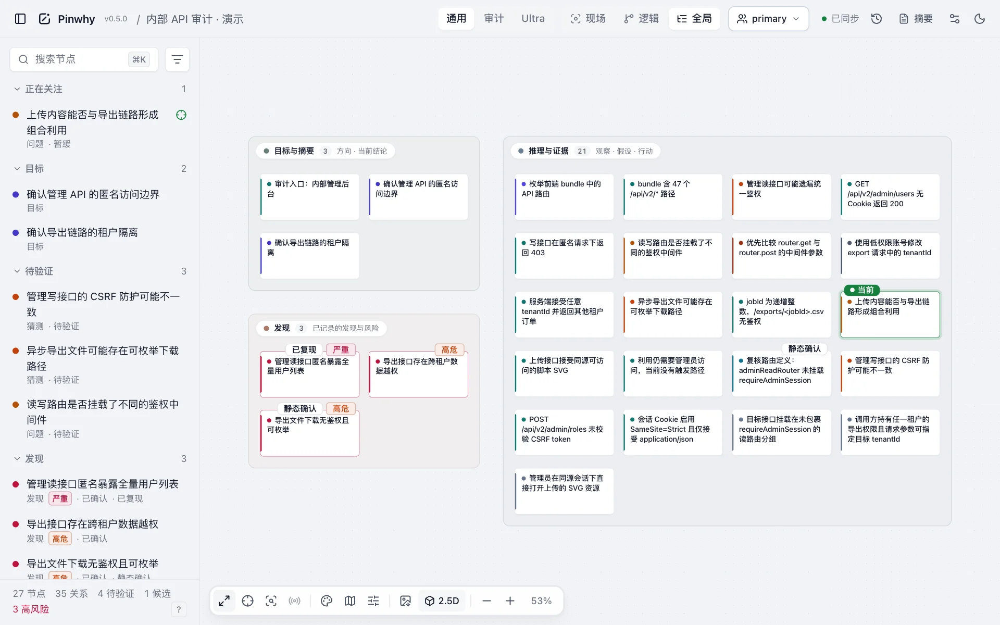
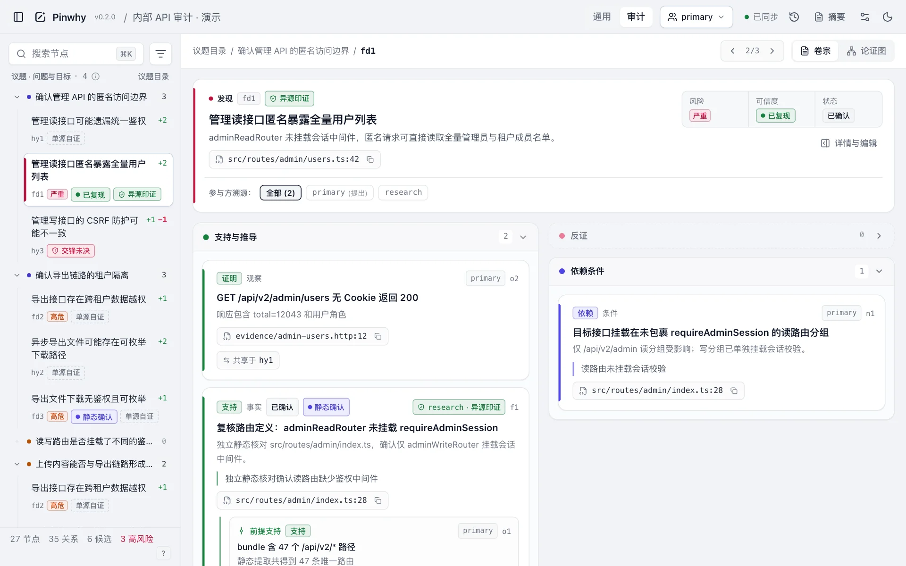

<p align="center">
  <picture>
    <source media="(prefers-color-scheme: dark)" srcset="https://raw.githubusercontent.com/Fruit-Guardians/pinwhy/main/design/pinwhy-logo/pinwhy-logo-light.svg">
    
  </picture>
</p>

<h3 align="center">给 AI Agent 留下判断的依据</h3>

<p align="center">
  与宿主无关的 Agent 外置记忆与实时可视化工作台。<br>
  把关键判断、正反证据与当前焦点留在项目本地——跨会话无缝接续，让人随时看清推理来龙去脉。
</p>

<p align="center">
  <a href="https://pinwhy.bx33661.com">官方网站</a> ·
  <a href="#quick-start">快速开始</a> ·
  <a href="#features">核心能力</a> ·
  <a href="#daily-use">使用方式</a> ·
  <a href="#cli">常用命令</a> ·
  <a href="https://github.com/Fruit-Guardians/pinwhy/issues">问题反馈</a>
</p>

<p align="center">
  <a href="https://www.npmjs.com/package/pinwhy"></a>
  <a href="https://nodejs.org/"></a>
  
  <a href="LICENSE"></a>
</p>

<a id="workspace"></a>

<p align="center">
  <picture>
    <source media="(prefers-color-scheme: dark)" srcset="https://raw.githubusercontent.com/Fruit-Guardians/pinwhy/main/site/public/shots/stage-all-zh-dark.webp">
    
  </picture>
</p>

---

<a id="introduction"></a>

## 为什么需要 Pinwhy

一次复杂排障、架构摸底或安全审计，往往跨越多轮对话、多个分支甚至多个 Agent。一旦触发上下文压缩或切换会话，线性聊天记录很难交代清楚：**之前试过哪些方向、为什么排除某个猜测、哪条结论真有证据支撑。**

**Pinwhy** 将探索过程中的目标、假设、正反证据与未决问题结构化地保存在项目本地（`.pinwhy/`）：

- **对 Agent**：压缩或换会话后按 Token 预算精准读回现场，不丢上下文、不重复踩坑。
- **对你**：在浏览器工作台中直观审视推理脉络与阶段战果，随时补充观察、点拨方向或多人交接。

<a id="features"></a>

## 核心能力

- **证据化推理图谱**：观察、猜测、结论与问题独立成点，通过 `supports`、`contradicts`、`depends-on`、`supersedes` 等显式关系还原判断演变。
- **跨会话与多 Agent 接力**：通过检查点与预算化上下文恢复现场；多 Agent 共享同一块黑板，各自保留独立关注位置与署名。
- **一板多视图工作台**：
  - **通用视图**：提供现场、逻辑与全局 2D / 3D 视图，适合日常研发排障与代码调研。
  - **安全审计模式**：围绕议题矩阵与双翼卷宗对照支持证据、反证和成立前提。
  - **Ultra 覆盖底座**（可选 `pinwhy-ultra`）：面向大规模审查，确定性追踪文件切片覆盖、探针与跨模块依赖盲区。
- **本地优先，零依赖交付**：零运行时第三方依赖，数据留在项目本地 `.pinwhy/`（自动生成 `.gitignore`），支持导出单文件离线 HTML、Markdown、Mermaid 与 SARIF 2.1.0。

<a id="requirements"></a>
<a id="manual-install"></a>
<a id="quick-start"></a>

## 快速开始

环境要求：**Node.js ≥ 18**（支持 macOS、Linux、Windows）。

### 1. 安装 CLI

```sh
npm install -g pinwhy
pinwhy --version
```

安装包内含 CLI、Web 工作台与完整 Agent Skill，零额外构建依赖。

### 2. 一句话交给 Agent 接入（推荐）

打开你的项目，直接将下面这句话发给你的 AI Agent：

> 请阅读 https://github.com/Fruit-Guardians/pinwhy 的接入说明，为当前项目安装或复用 Pinwhy，按当前宿主配置完整 Skill 并打开工作台。保留已有记录，完成后告诉我访问地址。

<a id="agent-integration"></a>

### 3. 或在终端按宿主配置

| 宿主环境 | 快速接入命令 |
| --- | --- |
| **Claude Code**（含 Skill、自动恢复 Hook 与后台服务） | `pinwhy setup --title "我的项目" --open` |
| **Codex / Cursor / Gemini CLI / OpenCode / Copilot CLI / OMP** | `pinwhy init --title "我的项目"`<br>`pinwhy skill install`（方向键选项目或 `--user` 全局安装）<br>`pinwhy serve --open` |
| **DeepSeek Harness** | 安装原生插件 [`dsh-pinwhy`](https://github.com/Fruit-Guardians/pinwhy/blob/main/plugins/dsh-pinwhy/README.md)，内置 11 个原生工具与内嵌画板 |

> 更多非交互脚本参数（如 `--host cursor`、`--all`）与后台常驻服务说明见 [Agent 接入指南](skills/pinwhy/references/setup.md)。

<a id="daily-use"></a>

## 日常工作流

### 第一步：交代任务，边探边记

加载 Pinwhy Skill 后，像平时一样用自然语言布置任务，让 Agent 把关键转折记在黑板上：

> 排查主题设置在重启后失效的原因。请用 Pinwhy 记录目标、关键假设和验证证据，区分待验证猜测与已确认事实，并在发现反证或切换方向时及时更新。

### 第二步：在工作台审视与协同

运行 `pinwhy serve --open`（或打开 Agent 返回的地址），即可实时跟进探查现场：

- **切换阅读视角**：在通用图谱、安全审计卷宗与时间线检查点之间无缝切换，浏览操作只读不干扰 Agent 游标。
- **人机直接联动**：你可以直接在页面上补充线索、修正状态或提出新问题，写入内容会自动进入后续 Agent 恢复上下文。

<p align="center">
  <picture>
    <source media="(prefers-color-scheme: dark)" srcset="https://raw.githubusercontent.com/Fruit-Guardians/pinwhy/main/site/public/shots/stage-audit-zh-dark.webp">
    
  </picture>
</p>

### 第三步：暂停存档，跨会话续接

- **离开或压缩前**：让 Agent *“保存当前 Pinwhy 检查点，写清已确认结论、未决问题与下一步关注点”*。
- **开启新会话时**：告诉新会话 *“从当前项目的 Pinwhy 恢复现场并继续推进”*，Agent 会按预算读回核心脉络并按需展开细节。

<a id="cli"></a>

## 常用命令

日常记录通常由 Agent 自动完成；你也可以随时通过终端查看、导出或备份：

```sh
pinwhy status                         # 查看当前项目黑板与工作台在线状态
pinwhy serve --open                   # 启动并在浏览器打开本地可视化工作台
pinwhy stop                           # 停止当前项目的本地工作台服务
pinwhy digest                         # 终端速览当前焦点、开放问题与近期进展
pinwhy search "鉴权"                  # 按关键词或条件检索节点记录
pinwhy show <节点ID>                  # 查看单条判断的完整内容与关联证据
pinwhy export --out board.html        # 导出零依赖单文件离线交互 HTML
pinwhy export --format markdown       # 导出 Markdown / Mermaid / SARIF 2.1.0 报告
pinwhy backup --out ../pinwhy-backup  # 完整备份事件日志并生成完整性校验清单
pinwhy doctor                         # 诊断运行环境、宿主接入与日志健康度
```

<a id="release"></a>
<a id="upgrade"></a>

## 升级

```sh
npm install -g pinwhy@latest
pinwhy --version
```

若使用源码不可变版本管理（`release install`），可通过 `pinwhy release check` 检查更新，或运行 `pinwhy release --help` 查看版本切换与回滚命令。

<a id="troubleshooting"></a>

## 常见问题

**工作台打不开或端口被占用？**<br>
运行 `pinwhy status` 查看当前服务归属；若默认端口冲突，可执行 `pinwhy serve --port 0 --open` 自动分配空闲端口。

**Agent 没有主动写入记录？**<br>
确认当前会话已加载项目的 Pinwhy Skill（新安装 Skill 后部分宿主需新开会话生效），并在首轮指令中提示“使用 Pinwhy 记录本次任务”。

**数据保存在哪里，外发分享安全吗？**<br>
所有记录保存在项目本地 `.pinwhy/` 目录，初始化时自动包含 `.gitignore` 防止误提交。导出离线 HTML 时会自动剥离工具原始输出并脱敏项目外绝对路径，但对外分享前仍建议人工核对节点正文中的业务敏感信息。

<a id="documentation"></a>

## 进阶文档与生态

| 主题 | 入口 |
| --- | --- |
| 宿主接入、Hook 与常驻服务 | [Agent 接入指南](skills/pinwhy/references/setup.md) |
| 节点维度与关系语义参考 | [记录语义](skills/pinwhy/references/recording.md) · [可选记录方法](skills/pinwhy/methods/INDEX.md) |
| 多 Agent 协作与子任务汇总 | [并行 Agent 指南](skills/pinwhy/references/parallel-agents.md) |
| 全量切片覆盖与缺口调度 | [pinwhy-ultra Skill](skills/pinwhy-ultra/SKILL.md) · [协议说明](skills/pinwhy-ultra/references/protocol.md) |
| 代码安全审计场景包 | [pinwhy-code-audit](skills/pinwhy-code-audit/README.md) |
| DeepSeek Harness 原生插件 | [dsh-pinwhy 说明](https://github.com/Fruit-Guardians/pinwhy/blob/main/plugins/dsh-pinwhy/README.md) |
| Node.js 编程接口（SDK） | [pinwhy-core](https://github.com/Fruit-Guardians/pinwhy/blob/main/packages/pinwhy-core/README.md) |
| 版本记录与问题反馈 | [Releases](https://github.com/Fruit-Guardians/pinwhy/releases) · [GitHub Issues](https://github.com/Fruit-Guardians/pinwhy/issues) |

## 开源许可

基于 [MIT License](LICENSE) 开源发布。
